# KMP Workout Tracker

An offline workout tracker for Android and iOS, built from a single Kotlin Multiplatform codebase — shared UI (Compose Multiplatform), shared ViewModels and a shared SQLDelight database.

> The UI is currently in Turkish. English UI / i18n is on the [roadmap](#roadmap).

## Screenshots

| Home | Workout list | Active workout |
|:---:|:---:|:---:|
| 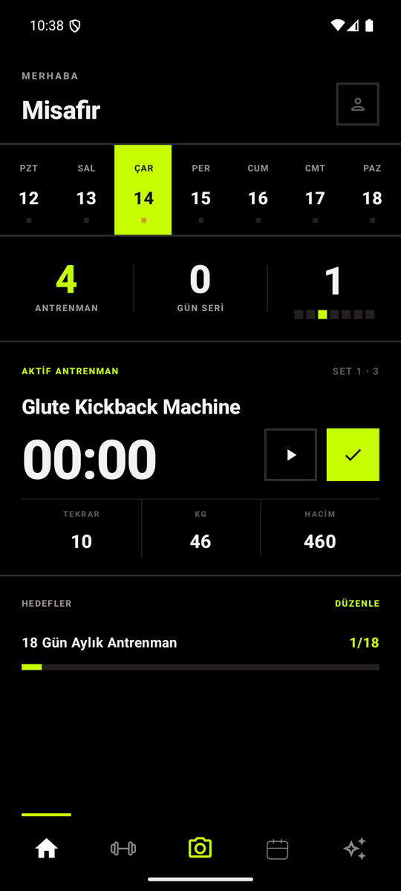 | 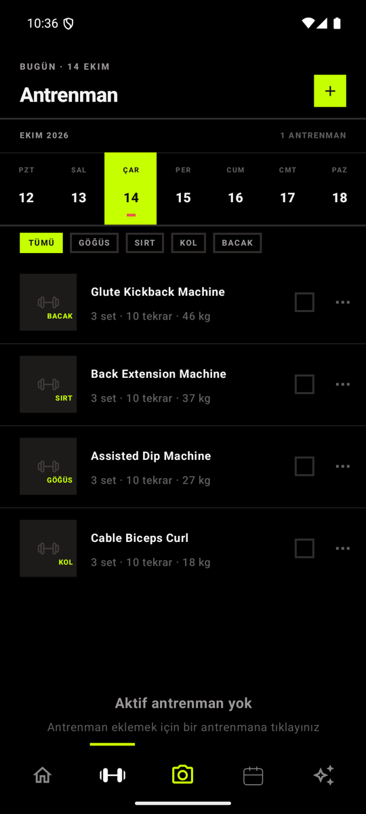 | 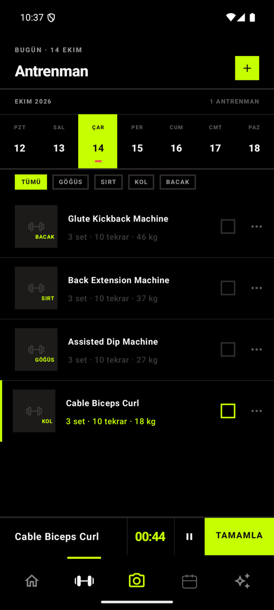 |
| **Rest timer** | **Progress stats** | **Calendar** |
| 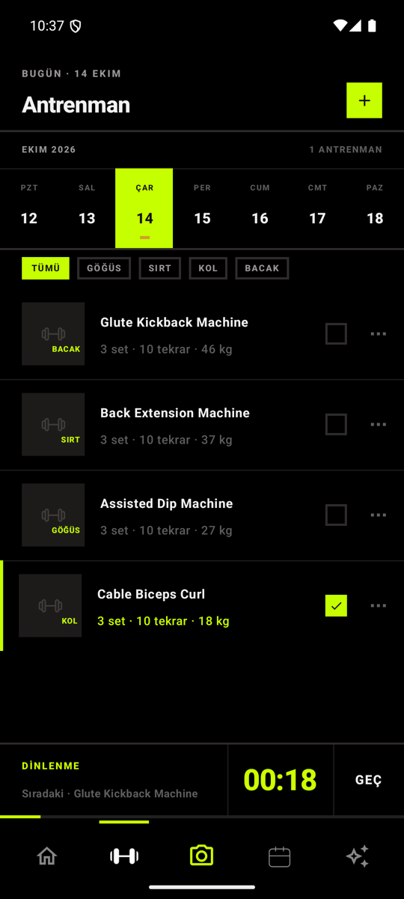 | 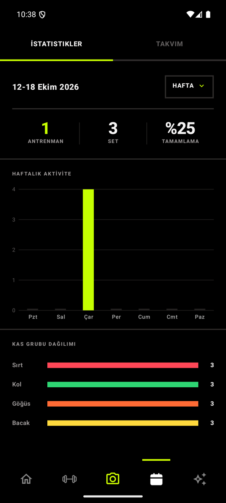 | 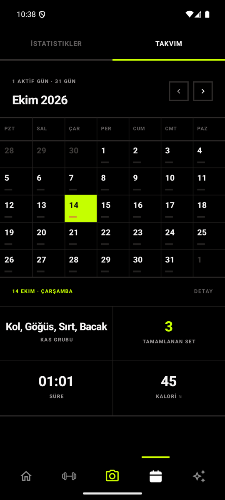 |
| **Add workout · 1/3 muscle group** | **Add workout · 2/3 exercise** | **Add workout · 3/3 sets, reps, weight, rest** |
| 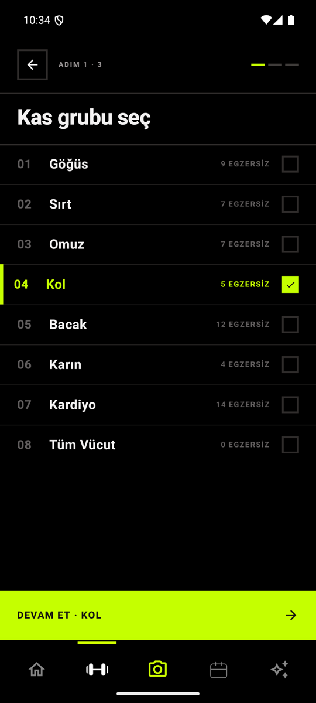 | 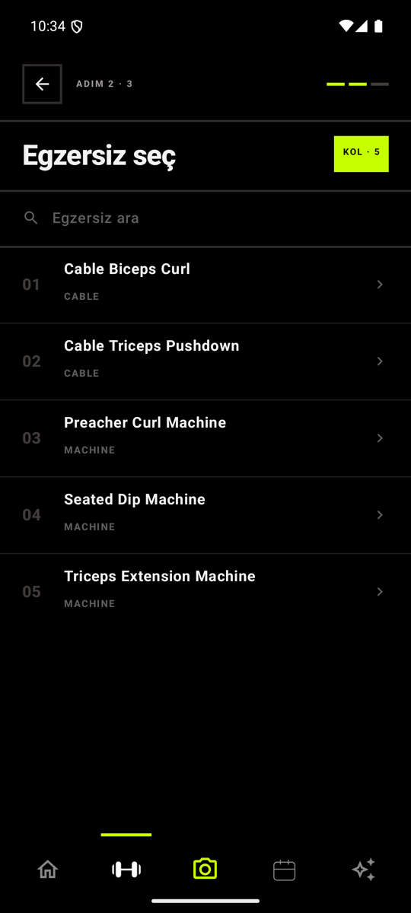 | 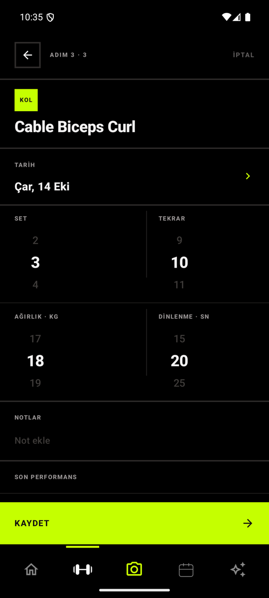 |
| **Goal wizard** | | |
| 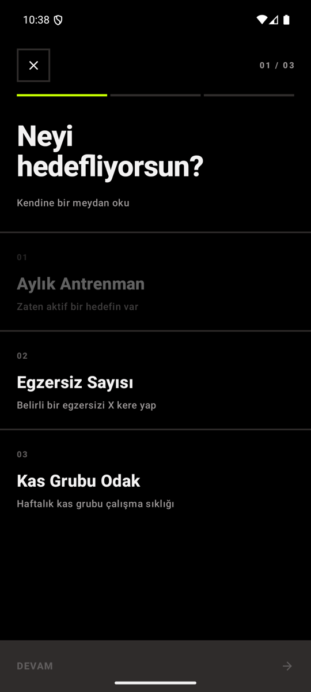 | | |

## Features

- **Weekly planner** — schedule exercises per day; reorder them with long-press drag and drop.
- **3-step add-workout wizard** — muscle group → exercise (from a bundled exercise catalogue) → sets, reps, weight, rest time, date and notes. Shows your last performance for the selected exercise.
- **Active workout player** — stopwatch per exercise, automatic rest countdown after an exercise is completed (with a skip button), then auto-advance to the next unfinished exercise.
- **Undo delete** — deleting a workout shows an undo bar for 4 seconds before anything is removed from the database.
- **Progress** — weekly / monthly / yearly completed workouts, sets, completion rate, daily activity chart and muscle-group distribution.
- **Calendar** — month view where each day is marked by completion status (full / partial / none), with a per-day summary (muscle groups, sets, duration, estimated calories).
- **Goals** — 3-step goal wizard (monthly workout days, exercise count, weekly muscle-group frequency) with progress bars on the home screen.
- **Profile** — body measurements and a profile photo from the gallery or camera.
- **Fully offline** — all data lives in a local SQLite database; the app makes no network requests.

## Engineering Highlights

### 1. Reactive progress pipeline

**Problem.** Ticking a set has to update the calendar colours, the day summary and the charts. Recalculating everything on every tap is wasteful, and pushing updates manually from each screen is error-prone.

**Solution.** Writes and reads are decoupled through a derived `day_progress` table:

1. `ProgressRepository.onSetCheckboxToggled` writes the tick to `workout_set_ticks`.
2. `debouncedRecomputeDay` cancels the previous pending job and schedules a new one after **150 ms**, so a burst of ticks results in one recomputation.
3. `recomputeDay(date)` counts planned vs. completed sets for that date and upserts one `day_progress` row with a status (`NO_PLAN` / `PARTIAL` / `FULL`) and completion percentage. Other mutations (deleting, moving or completing a whole exercise) call `recomputeDay` directly.
4. `observeMonthProgress` exposes the month's rows as a SQLDelight `Flow` (`asFlow().mapToList(...)`). `ProgressViewModel` collects it, so the calendar and stats re-render automatically whenever a row changes — no screen has to be told to refresh.

```kotlin
private fun debouncedRecomputeDay(date: String) {
    recomputeJob?.cancel()
    recomputeJob = scope.launch {
        delay(DEBOUNCE_DELAY) // 150 ms
        recomputeDay(date)
    }
}
```

Files: [`ProgressRepository.kt`](shared/src/commonMain/kotlin/com/example/aigymapp/repository/ProgressRepository.kt), [`ProgressViewModel.kt`](shared/src/commonMain/kotlin/com/example/aigymapp/ui/viewmodels/ProgressViewModel.kt), [`DayProgress.sq`](shared/src/commonMain/sqldelight/com/example/aigymapp/database/DayProgress.sq), [`FlowExtensions.kt`](shared/src/commonMain/kotlin/com/example/aigymapp/database/FlowExtensions.kt).

### 2. Data integrity for drag-and-drop ordering

**Problem.** Workouts were originally listed `ORDER BY id DESC`. Adding manual ordering needs a new column, and existing users must not see their list reshuffled after the update. A reorder also writes N rows, which must not be left half-applied.

**Solution.**

- `SchedulingRepository.reorderScheduledWorkouts(orderedIds)` writes every `sort_order` inside a single `database.transaction { }`. The ViewModel updates state optimistically first, then persists.
- [`migrations/2.sqm`](shared/src/commonMain/sqldelight/migrations/2.sqm) adds `sort_order` and backfills it so the existing visible order is preserved: each row's value is the number of rows on the same day with a larger id.

```sql
UPDATE scheduled_workouts
SET sort_order = (
    SELECT COUNT(*) FROM scheduled_workouts sw2
    WHERE sw2.date_epoch_day = scheduled_workouts.date_epoch_day
      AND sw2.id > scheduled_workouts.id
);
```

- On Android, `DatabaseDriverFactory.onOpen` also probes for the column (and for the `UserProfile` / `goals` tables and the `avatar` column) and applies the same DDL + backfill if it is missing, so databases created by older development builds are repaired on open.
- Queries sort by `sort_order ASC, id DESC`, so new rows (default `0`) have a deterministic position.

Files: [`SchedulingRepository.kt`](shared/src/commonMain/kotlin/com/example/aigymapp/repository/SchedulingRepository.kt), [`ScheduledWorkout.sq`](shared/src/commonMain/sqldelight/com/example/aigymapp/database/ScheduledWorkout.sq), [`DatabaseDriverFactory.kt` (Android)](shared/src/androidMain/kotlin/com/example/aigymapp/database/DatabaseDriverFactory.kt).

### 3. Active workout flow

All logic lives in [`WorkoutViewModel.kt`](shared/src/commonMain/kotlin/com/example/aigymapp/ui/viewmodels/WorkoutViewModel.kt):

- **Stopwatch** — `timerJob` is a coroutine that ticks once per second and also updates the day's total time (using a cache of the other workouts' durations, so it doesn't query the DB every second). Elapsed time is written to `scheduled_workouts.elapsed_time_ms` on pause, when switching to another workout and on reset, and is restored from the database when the workout is selected again.
- **Rest countdown** — `startRestIfNeeded` finds the next unfinished exercise (searching forward and wrapping around the day's list), and starts a countdown using the rest time configured for the completed exercise. If no rest time was configured it skips straight to the next exercise; `skipRest` cancels the countdown early.
- **Auto-advance** — when the countdown ends, the next exercise becomes the current workout.
- **4-second undo** — deleting a workout only hides it (`pendingDeleteWorkout`); a coroutine commits the delete after `PENDING_DELETE_UNDO_WINDOW_MS = 4000L`. `undoDeleteWorkout` just cancels that job, so nothing is ever restored — it was never deleted. A second delete during the window commits the first one immediately, so only one undo bar is shown at a time.
- **Guard rails** — a workout can't be marked complete while its timer is running, and the currently active workout can't be deleted.

### 4. Multiplatform architecture

- **One UI for both platforms.** All screens are Compose Multiplatform in `shared/commonMain`. Android hosts them from `MainActivity`; iOS hosts them through `MainViewController()` (`ComposeUIViewController`) embedded in a SwiftUI shell.
- **expect/actual database driver.** `DatabaseDriverFactory` is declared as `expect` in common code; the Android `actual` uses `AndroidSqliteDriver` (with `PRAGMA foreign_keys=ON` and the repair logic above), the iOS `actual` uses `NativeSqliteDriver`.
- **Layering.** ViewModels expose `StateFlow` state → repositories own all SQL access and run on `Dispatchers.Default` → SQLDelight generates type-safe query classes from the `.sq` files.

## Architecture

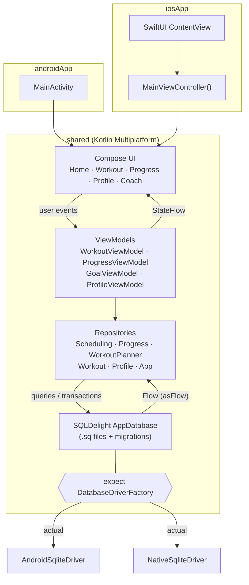

## Tech stack

| | |
|---|---|
| Language | Kotlin 2.0 |
| UI | Compose Multiplatform 1.7 (Material 3) |
| Persistence | SQLDelight 2.0 (Android & native SQLite drivers, coroutines extensions) |
| Concurrency | Kotlin Coroutines & Flow |
| Dates | kotlinx-datetime |
| Image picking / camera | [Peekaboo](https://github.com/onseok/peekaboo) (profile photo) |
| Serialization | kotlinx-serialization (model annotations) |

Targets: Android (minSdk 24, compileSdk 35) and iOS (arm64, simulator arm64, x64).

## Project structure

```
androidApp/   Android entry point (MainActivity)
iosApp/       Xcode project, SwiftUI shell hosting the shared Compose UI
shared/
  src/commonMain/kotlin/.../
    ui/           screens, components, navigation, theme, viewmodels
    repository/   data access layer
    models/       domain/UI models
    database/     expect DatabaseDriverFactory, Flow helpers
    utils/        date helpers, exercise seed data, progress calculations
  src/commonMain/sqldelight/   .sq schema/queries and .sqm migrations
  src/androidMain/, src/iosMain/   platform actuals
```

## Building

Requirements: JDK 17, Android SDK 35; for iOS, macOS with Xcode.

**Android**

```bash
./gradlew :androidApp:assembleDebug
```

Then install `androidApp/build/outputs/apk/debug/androidApp-debug.apk`, or run the `androidApp` configuration from Android Studio.

**iOS**

```bash
./gradlew :shared:compileKotlinIosSimulatorArm64
```

Open `iosApp/iosApp.xcodeproj` in Xcode, select your own development team under *Signing & Capabilities*, and run on a simulator. The Xcode build phase calls `./gradlew :shared:embedAndSignAppleFrameworkForXcode` to build the shared framework.

## Roadmap

Planned / not finished yet:

- **Coach assistant** — the Coach tab is currently a scripted UI prototype with canned replies; it is not connected to any model. Only its "suggest a new goal" action has a real effect (it adds a goal).
- **Camera tab** — placeholder screen.
- **Exercise form videos.**
- **Tests** — there are no meaningful unit or UI tests yet; the repository and progress calculation layers are the first candidates.
- **English UI / i18n** — user-facing strings are hardcoded in Turkish; move them to Compose Multiplatform resources.
- **iOS schema migrations** — the Android driver repairs older databases on open; the iOS driver currently relies only on SQLDelight's versioned migrations.
